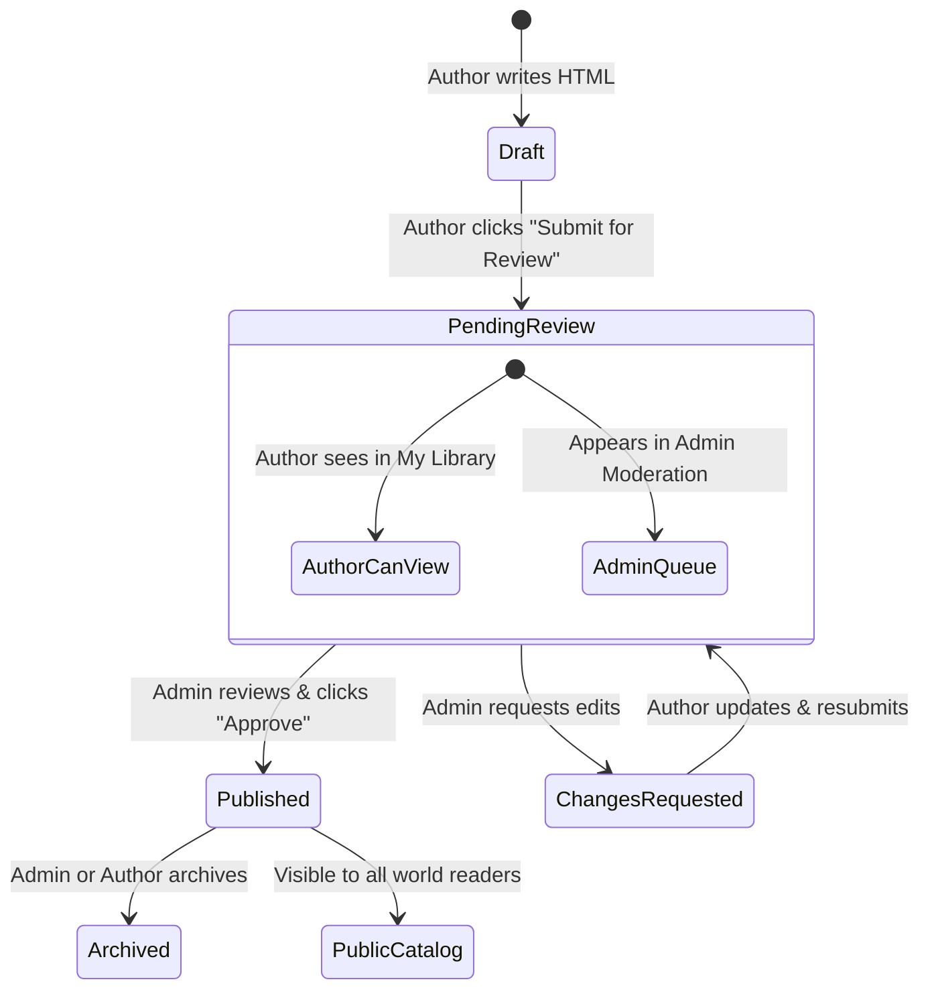

# IndexLib — UI & Interaction Design Specification

**Product Name:** IndexLib  
**Target URL (GitHub Pages):** `https://saurabhsukant75.github.io/IndexLib/`  
**Reference Exploration:** `https://saurabhsukant75.github.io/INDEX-DICTIONARY/#concepts`  
**Status:** Approved Specification  
**Version:** 2.0.0  
**Date:** October 31, 2026  

---

## 1. Product Identity & Design Vision

### 1.1 Brand Positioning
**IndexLib** is a digital sanctuary for knowledge—a visual library and publishing engine for short, beautifully structured HTML books. Where traditional web reading is cluttered with popups, banners, and infinite scrolling feeds, IndexLib provides a calm, editorial, book-centric experience.

### 1.2 Core Interaction Tenets
1. **The Book is the Centerpiece:** The library chrome, navigation bars, and controls exist solely to guide the reader into the book and get out of the way. Once inside, the book canvas commands focus.
2. **Clear Conceptual Relationships:** Learning is not just linear; ideas form interconnected semantic webs. The interactive **Concept Graph** allows readers to wander through concepts before committing to a reading path.
3. **Transparent Curation & Safe Publishing:** Anyone with an account can publish. Submissions immediately enter a `pending_review` state (visible to the author and admins). Once approved by an administrator, the book becomes globally public in the curated catalog.
4. **Offline Resilience & Privacy First:** Readers can save books, read offline, create private collections, and bookmark pages without creating an account. Signing in seamlessly unlocks cloud backup and cross-device sync.

---

## 2. Design System Foundations

### 2.1 Color Palette & Tokens
The palette evokes tactile editorial warmth—fine paper textures, subtle rule lines, ink-black text, and expressive pastel category accents.

| Token | Hex Value | Semantic Purpose |
|---|---|---|
| `--color-background` | `#f5f3ed` | Primary application canvas background (warm tactile newsprint) |
| `--color-sidebar` | `#f9f7f1` | Secondary surface for navigation drawers and sidebars |
| `--color-surface` | `#fffefa` | Card surfaces, modals, reader controls, and form panels |
| `--color-ink` | `#20241f` | High-contrast body text and dark action buttons |
| `--color-muted` | `#686b63` | Secondary labels, descriptions, and metadata stamps |
| `--color-line` | `#e3dfd5` | Thin structural divider lines and subtle card borders |
| `--color-accent` | `#d5ff58` | Electric lime-chartreuse highlight for active states and badges |
| `--color-green` | `#34654c` | Forest green for completed states and success confirmations |
| `--color-blue` | `#b9d7f6` | Soft sky blue for technology and systems concepts |
| `--color-peach` | `#ffb99d` | Warm peach for human behavior and psychology concepts |
| `--color-lavender` | `#ded7f5` | Soft lavender for design, philosophy, and society concepts |
| `--color-sand` | `#e7e3d4` | Neutral sand for introductory or foundational concepts |
| `--color-warning` | `#fef3c7` | Amber background for `pending_review` badges |
| `--color-danger` | `#dc2626` | Destructive actions, validation errors, and rejection states |

### 2.2 Typography Hierarchy
- **Editorial Headlines (`--font-editorial`):** Georgia, Garamond, "Times New Roman", serif. Used for page titles, book titles, and editorial quotes to establish an authentic literary atmosphere.
- **Interface & UI Text (`--font-body`):** Inter, Arial, ui-sans-serif, system-ui, sans-serif. Used for navigation items, buttons, form inputs, metadata chips, and data tables for crisp readability at small sizes.

```css
/* Typography Scale */
--text-xs:   0.75rem  /* 12px - Badges, timestamps, small tags */
--text-sm:   0.875rem /* 14px - Sidebar navigation, buttons, secondary metadata */
--text-base: 1.0rem   /* 16px - Standard body text, inputs */
--text-lg:   1.125rem /* 18px - Lead paragraphs, section subheaders */
--text-xl:   1.375rem /* 22px - Modal headers, book card titles */
--text-2xl:  1.75rem  /* 28px - Panel titles, concept node titles */
--text-3xl:  2.5rem   /* 40px - Main page editorial headlines (e.g., "Follow an idea.") */
```

### 2.3 Spatial Rhythm & Border Radii
- **Base Grid:** 4px baseline grid (spacing tokens: `4px`, `8px`, `12px`, `16px`, `24px`, `32px`, `48px`, `64px`).
- **Border Radii:**
  - Micro controls (`--radius-sm`): `6px` (buttons, badges, inputs).
  - Cards & Panels (`--radius-md`): `12px` (book cards, side panels, graph container).
  - Modals & Sheets (`--radius-lg`): `16px` (TOC drawer, preview modal, uploader).
  - Pills & Avatars (`--radius-full`): `9999px`.

---

## 3. Core Interaction Models & Screen Specifications

```mermaid
flowchart TD
    Shell[IndexLib App Shell]
    Shell --> Nav[Navigation: Home | Topics | Concepts | Paths | Library | Publish | Admin]
    
    Nav --> ViewConcepts["#concepts (Concept Graph)"]
    Nav --> ViewTopics["#topics (Taxonomy Tree)"]
    Nav --> ViewReader["#read/:bookId/:pageId (Sandboxed Reader)"]
    Nav --> ViewPublisher["#publish (Book Authoring & Review)"]
    Nav --> ViewAdmin["#admin/review (Admin Moderation Queue)"]
    
    ViewConcepts --> LinkBook[Select Book Card]
    ViewTopics --> LinkBook
    LinkBook --> ViewReader
    
    ViewPublisher --> SubmitBook[Submit Book for Review]
    SubmitBook --> ViewAdmin
    ViewAdmin --> ApproveBook[Admin Approves]
    ApproveBook --> LiveCatalog[Published in Global Catalog]
```

---

### 3.1 The Concept Graph Experience (`#concepts`)
*Reference: `https://saurabhsukant75.github.io/INDEX-DICTIONARY/#concepts`*

The Concept Graph transforms passive catalog browsing into an active intellectual journey. It visualizes typed, semantic relationships between ideas rather than a rigid syllabus.

```text
┌────────────────────────────────────────────────────────────────────────────────────────┐
│ IndexLib Header (Brand, Search Bar, Account / Sign In)                                │
├───────────────────────┬────────────────────────────────────────────────────────────────┤
│ Sidebar               │ Follow an idea.                                                │
│ ├─ Explore            │ The knowledge graph shows how concepts relate.                 │
│ │  ├─ Topics          ├─────────────────────────────────┬──────────────────────────────┤
│ │  ├─ Concepts ●      │ Interactive Relationship Graph  │ Selected Concept Panel       │
│ │  └─ Learning Paths  │                                 │                              │
│ ├─ My Space           │    (Attention) ──explains──►    │ Attention                    │
│ │  ├─ My Learning     │         ▲          (Incentives) │ Who controls your focus?     │
│ │  └─ My Library      │         │               │       │                              │
│ └─ Author Tools       │    introduces        applies    │ Books that explain it:       │
│    ├─ Publish Book    │         │               ▼       │ ┌──────────────────────────┐ │
│    └─ Admin Review    │    (Engagement) (Interface)    │ │ 01 The Attention Economy │ │
│                       │                                 │ └──────────────────────────┘ │
│                       │ [List Relationships Table ▼]    │ [Start Reading →]            │
└───────────────────────┴─────────────────────────────────┴──────────────────────────────┘
```

#### Interaction Flow:
1. **Interactive Canvas (SVG/Canvas):**
   - Each concept is rendered as a circular node colored according to its primary domain (`#d5ff58` for Attention, `#b9d7f6` for Incentives, etc.).
   - Directed relationship edges connect nodes with arrowhead markers and clear typographic relationship labels (`explains`, `introduces`, `applies`, `requires`, `contrasts_with`).
   - Hovering over a node scales it gently (`transform: scale(1.08)` with ease-out cubic bezier) and emphasizes its incoming and outgoing connected edges with high-contrast `#20241f` strokes while dimming unrelated edges to 30% opacity.
2. **Keyboard Accessibility:**
   - Every node has `tabindex="0"`, `role="button"`, and `aria-pressed="true|false"`. Pressing `Enter` or `Space` activates the node. Arrow keys allow navigating between adjacent connected nodes.
3. **Selected Concept Panel (Right Column):**
   - Updates instantly with smooth micro-fade transition (`opacity 0.2s ease-in-out`).
   - Displays the concept title, editorial definition, and all linked books that touch this concept, categorized by their link role (`explains`, `introduces`, or `applies`).
   - Clicking any book card navigates directly into the Reader view for that book.
4. **Accessible Relationship List:**
   - An expandable `<details>` element beneath the graph provides a clean, machine-readable HTML `<ul>` list of all active relationships for screen-reader users and keyboard power navigators.

---

### 3.2 Reusable Book Reader (`<HtmlBookReader />`)
*Route: `#read/:bookId/:pageId`*

The reader shell wraps the independent HTML book, giving the user total immersion while maintaining safety and navigation anchors.

```text
┌────────────────────────────────────────────────────────────────────────────────────────┐
│ ← Library  |  The Attention Economy · 01  (Page: chapter-1)   |  Zoom: [1x] [A-] [A+] │
│ [★ Save]   [✓ Complete]   [☆ Bookmark Page]   [Share ⎘]       |  [☰ Contents]         │
├────────────────────────────────────────────────────────────────────────────────────────┤
│ [Progress Bar: ████████████░░░░░░░░░░░░░░░░░░░░░░░░░░░░░░░░░░░░░░░░░░░░░░ 28%]        │
├────────────────────────────────────────────────────────────────────────────────────────┤
│                                                                                        │
│                                                                                        │
│                     ┌────────────────────────────────────┐                             │
│                     │      SANDBOXED IFRAME CANVAS       │                             │
│                     │                                    │                             │
│                     │  # Chapter 1: The New Currency     │                             │
│                     │                                    │                             │
│                     │  Attention is scarce. When         │                             │
│                     │  information is plentiful, human   │                             │
│                     │  attention becomes the limiting... │                             │
│                     │                                    │                             │
│                     └────────────────────────────────────┘                             │
│                                                                                        │
├────────────────────────────────────────────────────────────────────────────────────────┤
│ ◄ Previous Page                                                          Next Page ►   │
└────────────────────────────────────────────────────────────────────────────────────────┘
```

#### Interaction Flow & Security Model:
1. **Sandboxed Isolation:**
   - Embedded via `<iframe sandbox="allow-scripts" referrerpolicy="no-referrer">`. No access to parent cookies, IndexedDB, or localStorage.
2. **PostMessage Handshake (`index-dictionary.book`):**
   - Book dispatches `book-ready` upon mounting, sending its valid page IDs.
   - When the user navigates inside the book, the book dispatches `page-changed` with `{ bookId, pageId }`.
   - The React reader validates the message schema, updates the route URL fragment (`#read/:bookId/:pageId`), updates the progress indicator, and synchronizes with IndexedDB.
3. **Reader Toolbar Features:**
   - **Back Action:** Returns to previous view (Library, Concepts, or Search) preserving scroll position.
   - **Table of Contents Drawer:** Slides out from the right displaying all chapters/pages with active indicators and click-to-jump.
   - **Zoom Controls:** Adjustable viewport scale factor (`85%`, `100%`, `115%`, `130%`) adjusting comfortable reading font sizes without horizontal breakage.
   - **Bookmark Toggle:** Adds/removes the current page from the user's private bookmarks list.
   - **Share & Deep-link:** Copies verified URL directly pointing to the specific page.

---

### 3.3 Reusable Book Publisher (`<HtmlBookPublisher />`)
*Route: `#publish`*

The publisher provides a guided, self-serve authoring studio for creators to inspect, validate, preview, and submit visual HTML books.

#### The 4-Step Publishing Workflow:

```text
┌────────────────────────────────────────────────────────────────────────────────────────┐
│  (1) Upload HTML  ──►  (2) Validate & Preview  ──►  (3) Metadata  ──►  (4) Submit     │
├────────────────────────────────────────────────────────────────────────────────────────┤
│ Drop your visual HTML book here (.html or .htm up to 5 MiB)                            │
│ ┌────────────────────────────────────────────────────────────────────────────────────┐ │
│ │  Drag and drop book file here, or [Browse Files]                                   │ │
│ └────────────────────────────────────────────────────────────────────────────────────┘ │
│                                                                                        │
│ Validation Checklist:                                                                  │
│  [✓] HTML5 DOCTYPE & UTF-8 encoding valid                                              │
│  [✓] Responsive viewport meta tag detected                                             │
│  [✓] 6 unique navigable Page IDs found: [cover, intro, ch1, ch2, recap, sources]      │
│  [✓] Security check: zero prohibited external script CDNs detected                     │
│  [✓] Protocol bridge: index-dictionary.book communication script present               │
│                                                                                        │
│ Live Sandboxed Preview:                                                                │
│ ┌────────────────────────────────────────────────────────────────────────────────────┐ │
│ │ [HtmlBookReader Component rendering live Blob URL with sandbox isolation]         │ │
│ └────────────────────────────────────────────────────────────────────────────────────┘ │
│                                                                                        │
│ Book Metadata & Categorization:                                                        │
│  Title:       [The Architecture of Habit Loop                         ]                │
│  Summary:     [Why behavioral cues prompt automatic responses in apps.]                │
│  Reading Time:[12] minutes        Primary Topic: [Technology / UX  ▼]                  │
│  Concept Tags:[Attention (+)] [Incentives (+)] [Design (+)]                            │
│                                                                                        │
│ Submission Actions:                                                                    │
│  [Save as Private Import] (Offline Only)   |   [Submit for Public Review →]            │
│  Status: "Will be set to 'Pending Review' awaiting administrator approval."            │
└────────────────────────────────────────────────────────────────────────────────────────┘
```

---

### 3.4 Moderation & Approval Workflow (`#admin/review`)

To maintain high editorial quality while welcoming community contributions, IndexLib employs a two-tier review system:



#### Admin Review Queue UI:
- **Badge Indicators:**
  - `Draft` (Gray pill): Author working locally.
  - `Pending Review` (Amber pill): Submitted by author, awaiting moderation.
  - `Published` (Green pill): Globally visible in catalog.
  - `Archived` (Muted red pill): De-listed from catalog.
- **Admin Actions:**
  - One-click **"Approve & Publish"**: Updates status to `published` in Supabase `catalog_books` table.
  - **"Reject / Request Changes"**: Author receives feedback note in their Account dashboard.
  - **"Archive"**: Soft-deletes from public view while preserving database integrity.

---

## 4. Responsive Layout & Mobile Behavior

| Viewport | Sidebar Behavior | Concept Graph Behavior | Reader Behavior |
|---|---|---|---|
| **Desktop (> 1024px)** | Fixed 260px left sidebar under top header. | Side-by-side: 65% SVG canvas, 35% detail card. | Full height frame with top control bar and sticky bottom nav. |
| **Tablet (768px – 1023px)** | Collapsible sidebar with toggle icon in top bar. | Stacked: SVG canvas on top, detail card underneath. | Responsive frame with collapsible toolbar icons. |
| **Mobile (< 767px)** | Off-canvas slide-out drawer with backdrop scrim. | Responsive pinch-to-zoom SVG with bottom sheet detail drawer. | Full-screen reader view; top bar auto-hides on downward scroll, reveals on tap. |

---

## 5. Accessibility (WCAG 2.1 AA) Compliance
1. **Contrast Ratio:** Text-to-background contrast exceeds `4.5:1` across all body copy (`#20241f` on `#f5f3ed` yields `13.2:1`).
2. **Focus Visibility:** All interactive buttons, links, inputs, and SVG nodes display a prominent 2px solid `#20241f` focus ring with a 2px offset.
3. **Screen Readers:** ARIA landmarks (`<header role="banner">`, `<nav role="navigation">`, `<main role="main">`, `<aside role="complementary">`), polite live regions for progress updates, and text alternatives for every SVG edge and node.
4. **Motion Sensitivity:** Respects `prefers-reduced-motion: reduce` by disabling smooth scrolling transitions and graph node pulse animations.
